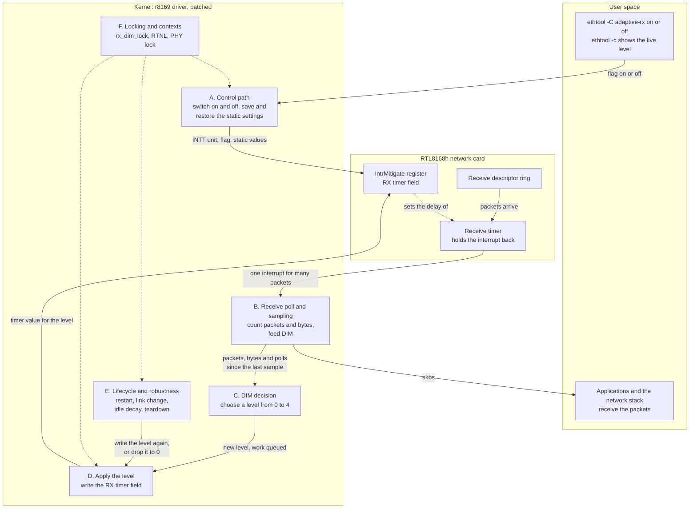

# Diagram 0: How the project works (overview)

This is the main diagram. It shows the parts of the system as six boxes (A to F) and what flows between them. Each box is a group of functions that is drawn in detail in its own diagram, listed under the picture. Read this one first, then open the detail diagram of the box you want to understand.

Exported image: [`img/00-overview.svg`](img/00-overview.svg) ([PNG](img/00-overview.png)).

## The idea in one paragraph

The card can hold back its receive interrupt for a short time, so that one interrupt covers several packets. A longer hold saves the CPU work of many interrupts when packets come fast, and costs latency when packets come one at a time. The driver therefore watches the traffic (box B), lets the kernel's DIM library judge it (box C), and sets the card's timer to a short or a long value (box D). The user only switches the mode on or off (box A). Boxes E and F keep this correct when the link or the device restarts and when several parts of the kernel run at once.

## The boxes and their detail diagrams

| Box | What it does | Main functions | Detail diagram |
|---|---|---|---|
| A. Control path | Turns adaptive mode on and off, saves and restores the user's static RX settings, chooses the timer unit | `rtl_set_coalesce()`, `rtl_get_coalesce()`, `rtl_write_coalesce()` | [04 ethtool control](04-ethtool-control.md) |
| B. Receive poll and sampling | Counts received packets and bytes and calls DIM, except for single packets at level 0 | `rtl8169_poll()`, `rtl_rx()`, `rtl_rx_dim_update()` | [01 poll and sampling](01-poll-and-sampling.md) |
| C. DIM decision | Compares the last 64 polls with the earlier ones and moves one level up or down | `net_dim()` (kernel library) | [02 DIM decision](02-dim-decision.md) |
| D. Apply the level | Converts the level to timer units and writes the RX timer field of `IntrMitigate` | `rtl_rx_dim_work()`, `rtl_rx_dim_apply()`, `rtl_rx_dim_units()` | [03 apply the level](03-apply-level.md) |
| E. Lifecycle and robustness | Writes the level again after a restart, recomputes it after a speed change, drops it to 0 when traffic stops, cancels work on teardown | `rtl_rx_dim_restore()`, `rtl_rx_dim_link_work()`, `rtl_rx_dim_decay_work()`, `rtl8169_down()` | [05 lifecycle](05-lifecycle.md) |
| F. Locking and contexts | Says which code runs where and which lock it takes | `rx_dim_lock`, RTNL, PHY lock | [06 locking](06-locking.md) |

Two diagrams cover the work around the code: [07 measurement setup](07-measurement-setup.md) (the two machines, the scripts and the data flow) and [08 patch series and build](08-series-and-build.md) (the six patches and how they reach the running module). [09 phases](09-phases.md) shows how the project was built step by step.

## Related documents

- [Project explained](../project-explained.md), which tells the same story in prose.
- [Results explained](../results-explained.md), which uses this diagram to say where each result comes from.
- [Report](../report.md), sections 3 to 5.
