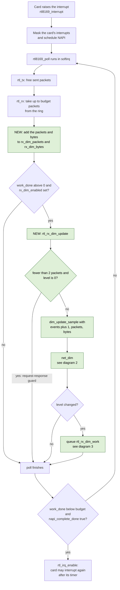

# Diagram 1: Receive poll and sampling (box B)

What happens from an interrupt to a sample for DIM. The new code is the shaded steps; the rest is the stock driver.

Exported image: [`img/01-poll-and-sampling.svg`](img/01-poll-and-sampling.svg) ([PNG](img/01-poll-and-sampling.png)).

## Steps

| Step | Function | Notes |
|---|---|---|
| Counters | `rtl_rx()` | The kernel's own receive statistics are per CPU and cannot be read as one number, so the driver keeps `rx_dim_packets` and `rx_dim_bytes`. They are written only here and read only in `rtl8169_poll()`, the same NAPI context, so no lock is needed |
| Condition | `rtl8169_poll()` | `work_done` is the number of packets taken in this poll. A poll with no packet is not an event |
| Event | `rtl_rx_dim_update()` | One event is one poll that received packets. DIM is called in every such poll, not only when the poll completes, because at line rate a poll may never complete |
| Guard | `rtl_rx_dim_update()` | At level 0 a poll with a single packet is dropped. It means the CPU kept up with the card, a longer timer would only add latency, and request-response traffic looks exactly like that. Above level 0 every poll counts, so DIM can always step back down |
| Sample | `dim_update_sample()` | Builds a `struct dim_sample` with the event count, packets and bytes and a time stamp |
| Decision | `net_dim()` | Library code, see [diagram 2](02-dim-decision.md) |

## Why the guard exists

The first version had no guard. A single request-response stream lost 5.8% of its transactions per second, because DIM kept leaving level 0 on statistics noise and every visit to level 1 delays each reply by the full 40 microsecond timer. The guard (patch 0005) removed the loss: 9,508 against 9,340 transactions per second in the same session.

## Related

[Overview](00-overview.md), [02 DIM decision](02-dim-decision.md), [06 locking](06-locking.md). Prose: [project explained, section 5](../project-explained.md). Results that depend on it: [results explained, request-response](../results-explained.md).
