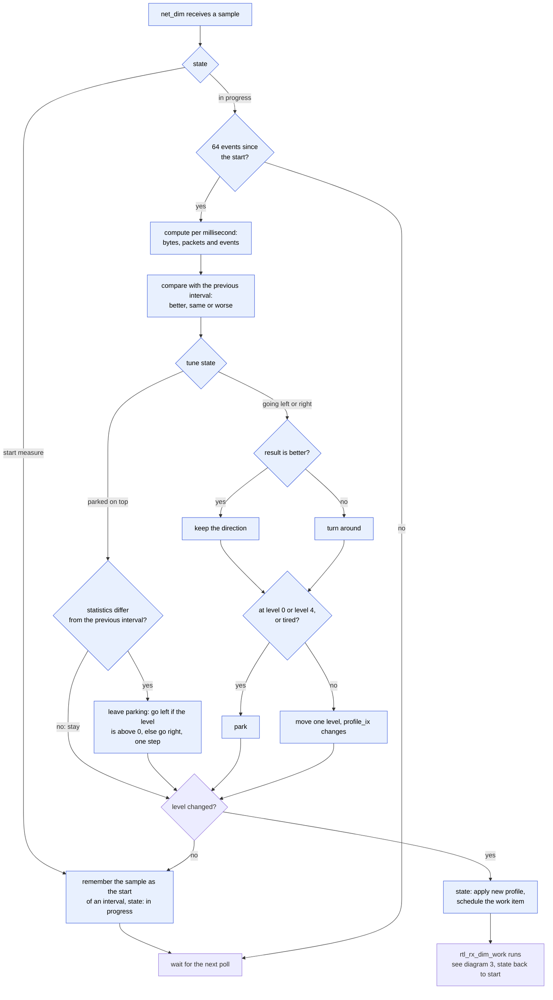

# Diagram 2: The DIM decision (box C)

DIM is the kernel's dynamic interrupt moderation library (`lib/dim`). The driver does not contain this algorithm; it only feeds it samples and gives it a table of levels. The diagram shows what the library does with each sample.

Exported image: [`img/02-dim-decision.svg`](img/02-dim-decision.svg) ([PNG](img/02-dim-decision.png)).

## The level table the driver supplies

DIM has five levels. The library's own tables assume counts that this card's 4 bit timer field cannot hold, so the driver has its own (`rtl_rx_dim_usecs`):

| DIM level (`profile_ix`) | Timer | Timer field at 1 Gbit/s (40 microsecond unit) | Meaning |
|---|---|---|---|
| 0 | 0 us | 0 | No moderation: every packet may interrupt at once. The starting level |
| 1 | 40 us | 1 | |
| 2 | 80 us | 2 | |
| 3 | 200 us | 5 | |
| 4 | 400 us | 10 | The longest hold the card can express at this unit: 15 units is the field limit |

## Behaviour that matters for the results

- DIM starts parked on top at level 0. It leaves the parking when the statistics of an interval differ from the previous one, and then moves one level per decision, so a rise from 0 to 400 us takes at least four decisions of 64 polls each. Under heavy small-packet load this happens in well under a second, because the polls come fast. The same rule makes DIM leave level 0 on statistics noise when the traffic is light, which is why the single-packet guard in [diagram 1](01-poll-and-sampling.md) exists.
- The comparison looks at bytes per millisecond first, then packets per millisecond (a difference of about 10 percent or more counts), then events per millisecond, where fewer events is better. When a move does not make things better, DIM turns around; at either end of the table it parks, and after about ten steps in a row it parks tired and waits.
- DIM judges only what it can count: packets, bytes and polls per millisecond. At 900 Mbit/s of large datagrams those counters change little between levels, which is why the ramp-up there is unreliable (a result in [results explained, section 7](../results-explained.md)).
- DIM only runs when polls happen. After traffic stops it never gets another sample, so the level would stay high; the idle decay in [diagram 5](05-lifecycle.md) fixes that.
- DIM keeps the level in `dim->profile_ix`. The driver reads that field as "the current level"; there is no separate variable.

## Related

[Overview](00-overview.md), [01 poll and sampling](01-poll-and-sampling.md), [03 apply the level](03-apply-level.md). Prose: [project explained, section 6](../project-explained.md).
