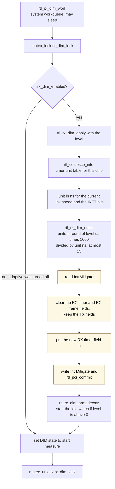

# Diagram 3: Applying a level to the card (box D)

DIM chose a level. This diagram shows how the level becomes a value in the card's `IntrMitigate` register.

Exported image: [`img/03-apply-level.svg`](img/03-apply-level.svg) ([PNG](img/03-apply-level.png)).

## What is written, and what is not

| Item | Written by the work function? | Why |
|---|---|---|
| RX timer field of `IntrMitigate` (bits 7:4) | Yes | This is the level |
| RX frame field of `IntrMitigate` (bits 3:0) | Cleared to 0 | The levels are timer-only: the hardware needs a timer whenever a frame limit is set, and a timer alone is enough |
| TX fields of `IntrMitigate` | No, kept as they are | The project is RX only, and the user may have set TX values with ethtool |
| `CPlusCmd` (the `INTT` unit bits and `PktCntrDisable`) | Never | These are written on the ethtool path and in `rtl_hw_start()`. Keeping the work function out of `CPlusCmd` means it is not a third writer next to them |

## Level to timer value

The timer field counts units, and the length of a unit depends on the link speed and the `INTT` bits. At 1 Gbit/s with `INTT` 1 the unit is 40 microseconds, so 40, 80, 200 and 400 us become fields 1, 2, 5 and 10 (seen on the card as `IntrMitigate` `0x0010`, `0x0020`, `0x0050` and `0x00a0`). At 100 Mbit/s the unit is 20.48 us and 80 us becomes field 4, as measured in test F5. A level that would be shorter than half a unit rounds to 0 (no moderation) instead of one whole unit.

## Related

[Overview](00-overview.md), [02 DIM decision](02-dim-decision.md), [05 lifecycle](05-lifecycle.md) (the other callers of the apply step), [06 locking](06-locking.md). Prose: [project explained, section 7](../project-explained.md).
