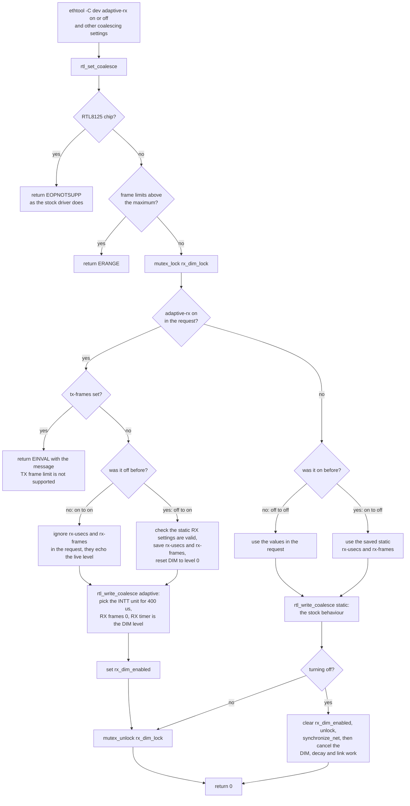

# Diagram 4: The ethtool control path (box A)

What `ethtool -C <dev> ...` does inside the driver, and how adaptive mode is turned on and off without losing the user's static settings.

Exported image: [`img/04-ethtool-control.svg`](img/04-ethtool-control.svg) ([PNG](img/04-ethtool-control.png)).

## The read side

`rtl_get_coalesce()` reads the live `IntrMitigate` register, so while adaptive mode is on, `ethtool -c` shows the level DIM has chosen (`rx-usecs` reads 0, 40, 80, 200 or 400 depending on the level) and `Adaptive RX: on`. The stock driver prints `Adaptive RX: n/a` and refuses the flag.

## Rules that follow from the code

| Rule | Reason |
|---|---|
| With adaptive mode off the driver behaves like the stock driver | `rtl_write_coalesce()` with `adaptive` false is the old body of `rtl_set_coalesce()`, moved unchanged |
| Turning it on keeps the user's static RX values, and turning it off puts them back | The values in an ethtool request while adaptive is on are only echoes of the live level, so they cannot be trusted as the user's wish |
| A TX frame limit is refused while adaptive is on | The RX levels are timer-only, and the hardware needs a timer whenever a frame limit is set |
| The `INTT` unit is chosen here, once, for the longest level (400 us) | At 1 Gbit/s the 400 us level needs the 40 us unit. Choosing it on the ethtool path means the work function never writes `CPlusCmd` |
| Turning it off waits for running polls, then cancels the work | After `synchronize_net()` no poll can still see the flag on. The work items would find the flag off and do nothing, but they must not run after a later re-enable |
| Everything runs under `rx_dim_lock` except the cancels | The cancels wait for work items that take the same mutex, so they run after it is released |

## Related

[Overview](00-overview.md), [03 apply the level](03-apply-level.md), [06 locking](06-locking.md). Prose: [project explained, section 8](../project-explained.md). Tests that exercise this path: T1 to T3 and F11 in [setup and testing](../setup-and-testing.md).
