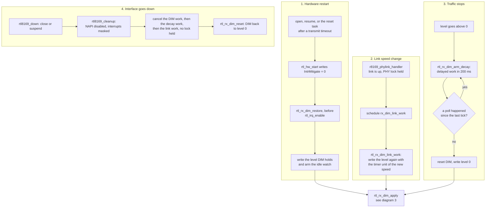

# Diagram 5: Lifecycle and robustness (box E)

Adaptive mode has to keep working when the card restarts, when the link changes speed, when traffic stops, and when the interface goes down. Each of the four cases has its own trigger and its own small piece of code (patch 0006).

Exported image: [`img/05-lifecycle.svg`](img/05-lifecycle.svg) ([PNG](img/05-lifecycle.png)).

## Why each case needs code

| Case | Problem without the code | What the code does | How it was tested |
|---|---|---|---|
| 1. Restart | The chip-specific start writes `IntrMitigate = 0`, so after a reset task the card would run with no timer while DIM still believes it is at, say, level 4 | `rtl_rx_dim_restore()` writes the level again at the end of `rtl_hw_start()`, before the interrupts are enabled. After open or resume DIM was reset by `rtl8169_down()`, so it writes level 0 | F4 (10 down and up rounds), F4b (forced reset with a debugfs test hook: the log showed `TEST restore: level 4, IntrMitigate 0x00a0`), F6 (suspend and resume) |
| 2. Link change | The length of a timer unit depends on the link speed, so the same field means a different time at 100 Mbit/s | A work item (the PHY handler holds the PHY lock, so it only schedules) writes the level again with the new unit. The `INTT` bits are left alone | F5 (1000, 100, 1000 Mbit/s: level 2 became field 4 of 20.48 us at 100 Mbit/s) |
| 3. Idle | DIM only runs when polls happen. After a burst it would never get another sample, the level would stay at 400 us, and the first packets of the next sparse traffic would each wait up to 400 us | A delayed work every 200 ms drops the level to 0 when no poll happened for a whole period | T7 (the problem, seen in Phase 2), F9 (0.39 s from the last packet to level 0), F10 (request-response right after a burst is not slowed) |
| 4. Down | A work item could run after the device was closed or while it is being reopened | The work items are cancelled in a fixed order after `rtl8169_cleanup()` has stopped NAPI, with no lock held, because the work items take `rx_dim_lock` themselves | F7 (36 minutes of stress: 19 link bounces and 20 module reloads under load with adaptive mode toggled every 100 ms), T10 (unload under load) |

## Related

[Overview](00-overview.md), [03 apply the level](03-apply-level.md), [06 locking](06-locking.md). Prose: [project explained, section 9](../project-explained.md). Results: [results explained, section 8](../results-explained.md).
