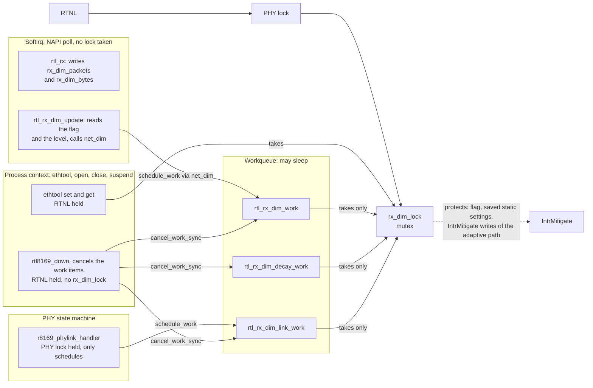

# Diagram 6: Locking and execution contexts (box F)

The driver code runs in four contexts at once. This diagram shows which context touches which data and which lock it takes. The rule that makes the whole design deadlock-free is that the work items take only `rx_dim_lock`, never RTNL or the PHY lock.

Exported image: [`img/06-locking.svg`](img/06-locking.svg) ([PNG](img/06-locking.png)).

## The locks

| Lock | Kind | Held by |
|---|---|---|
| RTNL | mutex | The networking core around open, stop and ethtool calls |
| PHY lock | mutex | The PHY state machine around `r8169_phylink_handler()` |
| `rx_dim_lock` | mutex (new) | `rtl_set_coalesce()`, the three work functions, `rtl_rx_dim_restore()` |

Order: RTNL, then PHY lock, then `rx_dim_lock`. Nothing takes RTNL or the PHY lock while holding `rx_dim_lock`.

## Why it works

- A work item that took RTNL could not be cancelled while RTNL is held, because `cancel_work_sync()` would wait for it. The work items take only `rx_dim_lock`, so `rtl8169_down()` (which runs under RTNL) can cancel them safely, the same pattern `virtio_net` uses.
- The PHY handler holds the PHY lock and must not take `rx_dim_lock` in the other order, so it only queues `rx_dim_link_work`.
- The NAPI poll never takes the mutex (it cannot sleep). The flag is written with `WRITE_ONCE()` under the lock and read with `READ_ONCE()` in the poll; the packet and byte counters are written and read only in NAPI context.
- The few remaining races (the decay work resetting DIM while `net_dim()` runs, the link work and the DIM work both writing the level) end with the register and DIM agreeing again after the queued work has run. They are listed with their reasons in `../locking.md`, section 4.

## Related

[Overview](00-overview.md), [05 lifecycle](05-lifecycle.md), [04 ethtool control](04-ethtool-control.md). Full notes: [`../locking.md`](../locking.md). Prose: [project explained, section 10](../project-explained.md).
