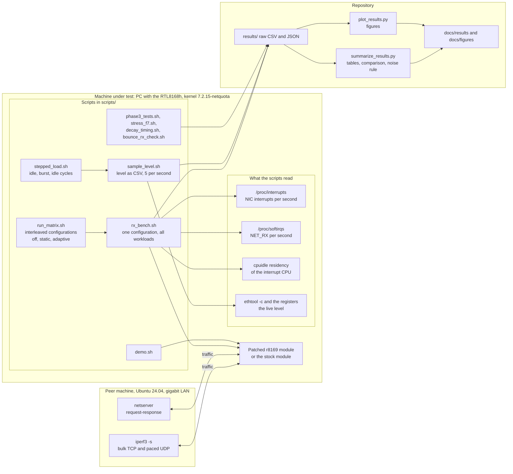

# Diagram 7: Measurement setup and data flow

Two machines, a set of scripts, and what the scripts read and write. This is how every number in the [results](../results-explained.md) was produced.

Exported image: [`img/07-measurement-setup.svg`](img/07-measurement-setup.svg) ([PNG](img/07-measurement-setup.png)).

## Workloads and what each one tests

| Workload (`rx_bench.sh -w`) | Traffic | What it shows |
|---|---|---|
| `idle` | none | Background interrupts |
| `rr` | one `netperf` TCP_RR stream, 64 byte messages | Latency traffic: must not get slower |
| `rrp` | eight parallel TCP_RR streams | The same with more load |
| `tcp` | `iperf3 -R` bulk TCP | Throughput traffic at line rate: nothing to win, must not lose |
| `udp` | `iperf3 -u -R`, 1448 byte datagrams, 100 to 900 Mbit/s | Heavy load with large packets |
| `udps` | `iperf3 -u -R`, 100 byte datagrams, 100 microsecond pacing timer, 50 to 200 Mbit/s | Heavy load with small packets: the case moderation is for |

## Configurations compared

`stock` (the unmodified module), `off` (the patched module, adaptive off), `static-L2` (a fixed 80 us timer), `static-L4` (a fixed 400 us timer) and `adaptive`. `run_matrix.sh` switches between the last four with `ethtool` only, in interleaved rounds with the order reversed on every second round, so drift in time does not line up with one configuration.

## Measures

NIC interrupts per second, NET_RX softirq runs per second, throughput, latency and transactions per second, loss and jitter, and the share of the wall time that the interrupt CPU was not in a cpuidle state. The cpuidle measure is used because the kernel on the PC samples `/proc/stat` only at the scheduler tick, which makes its busy and softirq percentages unreliable for paced traffic.

## Related

[Overview](00-overview.md), [08 patch series and build](08-series-and-build.md), [setup and testing](../setup-and-testing.md), [results explained, section 3](../results-explained.md).
