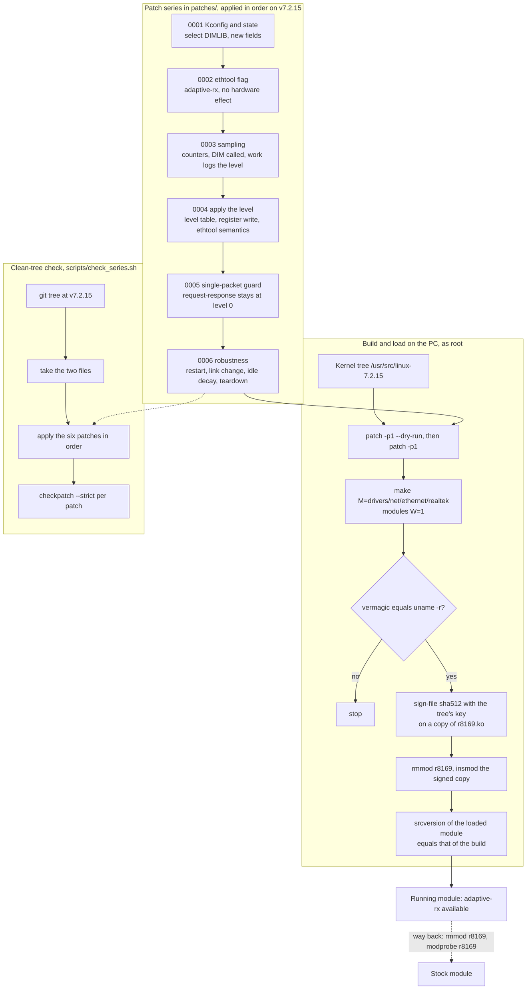

# Diagram 8: Patch series, build and load

How the six patches build on each other, and how they become the module that runs on the PC.

Exported image: [`img/08-series-and-build.svg`](img/08-series-and-build.svg) ([PNG](img/08-series-and-build.png)).

## The two kernel files

| File | Changed by |
|---|---|
| `drivers/net/ethernet/realtek/Kconfig` | 0001 |
| `drivers/net/ethernet/realtek/r8169_main.c` | 0001 to 0006 |

The complete list of changes, function by function, is in [kernel changes](../kernel-changes.md).

## Why it is built this way

- The kernel on the PC enforces module signatures (`CONFIG_MODULE_SIG_FORCE=y`), so a rebuilt module has to be signed with the key of the tree it was built from before `insmod`. The unsigned build output is left unchanged and the key never leaves the tree.
- `scripts/build_sign_load.sh` does the build, the vermagic check, the signing and the swap in one command.
- The series is split so that behaviour can be observed before any register is touched: 0003 only logs the level DIM chooses, and 0004 starts writing the register.
- The stock module stays installed, so `rmmod r8169; modprobe r8169` is always the way back. The card is the PC's only connection, so this is done at the console.

## Related

[Overview](00-overview.md), [07 measurement setup](07-measurement-setup.md), [setup and testing](../setup-and-testing.md), [kernel changes](../kernel-changes.md).
