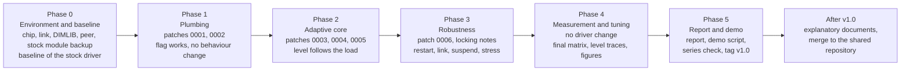

# Diagram 9: The project phases

How the project was built, and what each phase produced. Each phase ended with something that built and loaded.

Exported image: [`img/09-phases.svg`](img/09-phases.svg) ([PNG](img/09-phases.png)).

| Phase | Question it answered | Results file |
|---|---|---|
| 0 | What is the hardware and how does the stock driver behave? | [`phase_0_environment_and_baseline.md`](../results/phase_0_environment_and_baseline.md) |
| 1 | Can the flag be added without changing behaviour? | [`phase_1_plumbing.md`](../results/phase_1_plumbing.md) |
| 2 | Does the level follow the load, and does latency traffic stay unharmed? | [`phase_2_adaptive_core.md`](../results/phase_2_adaptive_core.md) |
| 3 | Does it survive restarts, link changes, suspend and stress? | [`phase_3_robustness.md`](../results/phase_3_robustness.md) |
| 4 | How much does it save, at what cost, and is the table right? | [`phase_4_measurement_and_tuning.md`](../results/phase_4_measurement_and_tuning.md) |
| 5 | Is it verified on a clean tree and can it be shown? | [`phase_5_report_and_demo.md`](../results/phase_5_report_and_demo.md) |

All phases are in this repository. Phases 0 to 3 were merged first; Phases 4 and 5 were done in a private repository and merged in afterwards (see [merge to the shared repository](../merge-to-shared-repo.md)).

## Related

[Overview](00-overview.md), [project explained, section 2](../project-explained.md), [setup and testing, section 6](../setup-and-testing.md).
