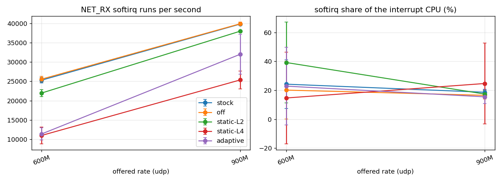
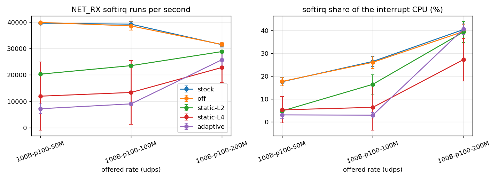
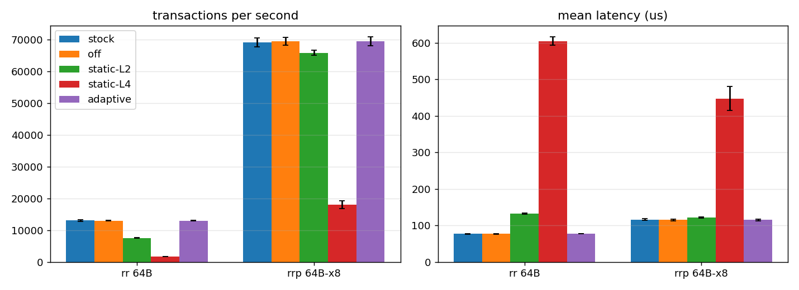
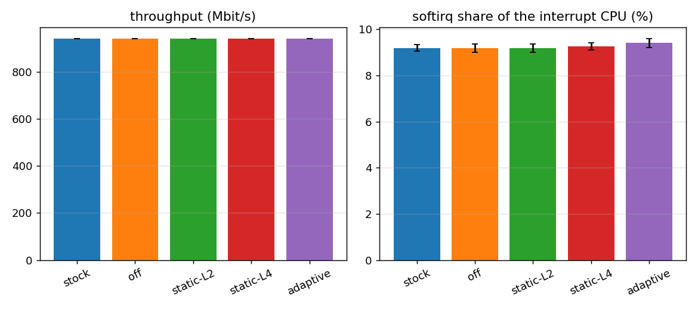
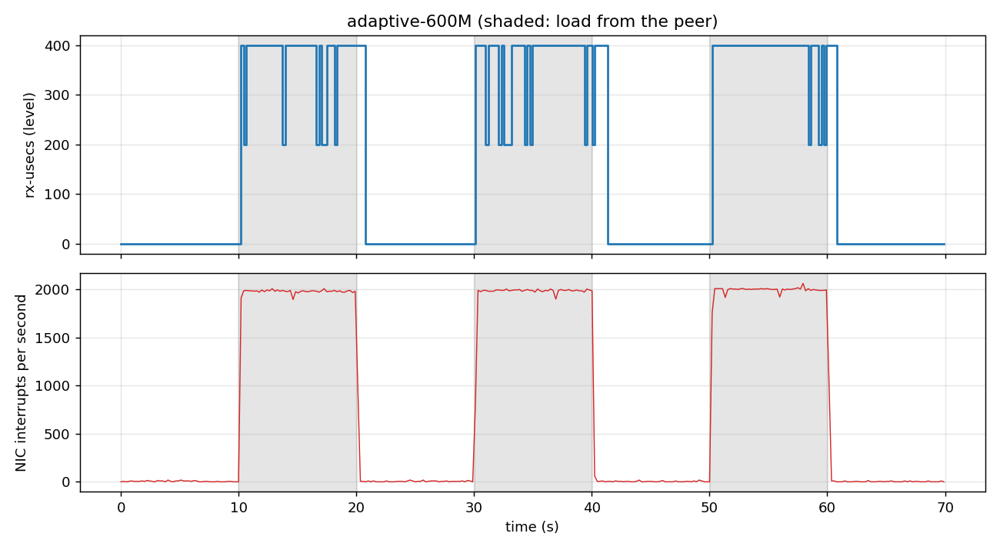

# Adaptive receive interrupt moderation for the Linux r8169 driver

Dhruv Rakeshbhai Patel, M.E. Computer Science, BITS Pilani Goa. Course project, Advanced Operating Systems (CS G623). Target kernel Linux 7.2.15. Repository: `Dhruv0306/r8169-adaptive-rx-dim` (phases 0 to 3, public) and its private continuation (phases 4 and 5).

## 1. Summary


The picture is the [overview diagram](diagrams/00-overview.md); the detail diagrams are listed in [`diagrams/README.md`](diagrams/README.md). Other documents: [project explained](project-explained.md), [results explained](results-explained.md), [kernel changes](kernel-changes.md), [setup and testing](setup-and-testing.md), [demo and questions](demo-and-questions.md).

**Goal.** The `r8169` driver (Realtek RTL8111/8168 Gigabit Ethernet) can ask the hardware to hold back receive interrupts so that one interrupt covers several packets, but only with a fixed delay set by hand through `ethtool -C`, and it starts with no delay. A fixed delay is a bad fit for changing traffic: it saves CPU time under a heavy load and slows every reply under a light one. The project makes the delay follow the load.

**What was built.** An adaptive mode, switched with `ethtool -C <dev> adaptive-rx on|off`, built on the kernel's DIM library (the library that drivers such as `virtio_net` use for this). DIM watches packets, bytes and poll events per millisecond and picks one of five levels. The driver maps the levels to timer values of 0, 40, 80, 200 and 400 microseconds and writes them to the receive timer field of the `IntrMitigate` register. The change is six patches against `v7.2.15`, 374 added and 31 removed lines in `r8169_main.c` and its `Kconfig`. With the flag off the driver behaves like the stock one.

**Main numbers** (RTL8168h at 1 Gbit/s, one peer, 12 runs per cell, mean over runs; section 7):

- Under heavy small-packet UDP (`udps` 50M and 100M) the receive softirq rate (NET_RX per second) falls by 77 to 82% and the interrupt CPU's non-idle time by 15 to 31%, with no change in throughput or loss. At 100 Mbit/s of 100 byte datagrams the NIC interrupt rate falls from about 16,900 to 3,300 per second. UDP at 600 Mbit/s: NET_RX -55%, CPU -22%.
- Request-response traffic (one stream or eight) is indistinguishable from the adaptive-off driver in transactions per second and in latency. A fixed 80 us timer costs 42% of the single-stream transactions per second and a fixed 400 us timer costs 87%.
- Bulk TCP at 941 Mbit/s is unchanged. It takes about 2 interrupts per second with or without moderation, so there is nothing to win.
- At 900 Mbit/s UDP the result is partial (NET_RX -20%, CPU -18% on average) because DIM often ramps up late there.

**Conclusion.** Adaptive moderation gives the benefit of a long timer under heavy small-packet load and the latency of no timer under light load, on this chip. The gain is in CPU and softirq work; bulk TCP has no headroom. The result is for one chip variant, one peer and one link speed.

## 2. Background


See [diagram 1](diagrams/01-poll-and-sampling.md) for the receive path and [diagram 2](diagrams/02-dim-decision.md) for what DIM does; a longer treatment is in [project explained, section 2](project-explained.md).
### 2.1 The receive path

`r8169` has one receive queue and one NAPI context. The interrupt handler `rtl8169_interrupt()` masks the interrupts and schedules NAPI. `rtl8169_poll()` then runs `rtl_tx()` and `rtl_rx()`, calls `napi_complete_done()` and unmasks the interrupts. Under a heavy load NAPI already batches packets, because the poll keeps running while packets are waiting. Interrupt moderation in hardware matters in the middle range, where packets come fast enough to cause many interrupts but not so fast that the poll never ends.

### 2.2 The `IntrMitigate` register

The chip has a 16 bit register `IntrMitigate` (offset 0xe2). Receive frame count is bits 3:0 (a field value `n` means `4n` frames), receive timer bits 7:4, transmit frame count bits 11:8 and transmit timer bits 15:12. The unit of the timers is set by the `INTT` bits of `CPlusCmd` and by the link speed, and is shared by receive and transmit; at 1000 Mbit/s the 8168 family unit is 5, 40, 80 or 160 microseconds. A timer field is only 4 bits, so the longest timer is 15 units. The hardware needs a timer whenever a frame count is set. The existing static `ethtool -C` path (`rtl_set_coalesce()`) writes these fields; RTL8125 chips return `-EOPNOTSUPP` from it and are out of scope.

### 2.3 DIM

DIM (`include/linux/dim.h`, `lib/dim`) is the kernel's library for dynamic interrupt moderation. The driver gives it a sample of counters (packets, bytes, events) with `net_dim()`. After 64 events it compares the new interval with the previous one (bytes per millisecond first, then packets, then events per millisecond, where fewer events is better) and moves one level up, one level down or stays. When the level changes it queues a work item, and the driver's work function applies the new level. The library has five levels. Its default tables use values that assume much larger counts than this hardware's 4 bit fields can hold, so the driver supplies its own table.

## 3. Design


The design is drawn in the [overview](diagrams/00-overview.md) and in diagrams [1](diagrams/01-poll-and-sampling.md) to [6](diagrams/06-locking.md); the patch order is in [diagram 8](diagrams/08-series-and-build.md).
The design is in `docs/plan.md` and the phase plans. The decisions that shaped the code:

| Decision | Why |
|---|---|
| Use the DIM library (handoff, section 8) | It is the kernel's established mechanism and `virtio_net` shows the pattern; a hand-written algorithm would be more code and harder to defend |
| RX only | Keeps the first version small; the receive fields of `IntrMitigate` can change without touching the transmit fields |
| An event is one call of `rtl8169_poll()` that received packets (Phase 2 D1), and `net_dim()` is called right after `rtl_rx()` in every such poll | At line rate the poll may never complete, so sampling only at `napi_complete_done()` would starve DIM |
| Own table, in microseconds, `{0, 40, 80, 200, 400}`, converted to timer units at apply time (D2) | The library's defaults do not fit 4 bit fields; the table includes the 200 us point measured in Phase 0 |
| `INTT` is chosen once, on the ethtool path, for the largest level (D3) | At 1 Gbit/s the 400 us level needs the 40 us unit. Keeping the only write of `CPlusCmd` on the ethtool path means the work function is not another writer of it |
| Timer-only levels (D4) | The stock timer-only path runs with `PktCntrDisable` set; a frame limit would add a rule the hardware must follow. A non-zero TX frame limit is refused while adaptive mode is on |
| One mutex, `rx_dim_lock`, and the work function takes only that mutex (D5, Phase 3 D6) | Lets the work be cancelled under RTNL without a deadlock, the same pattern as `virtio_net` |
| ethtool semantics (D6): `ethtool -c` shows the live register; off to on saves the static RX settings and starts at level 0; off again restores them | Makes the level visible for the demo and leaves the user's static settings intact |
| The work function writes only the RX bits of `IntrMitigate` (D7) | Keeps the TX timer and frame fields that ethtool may have set |
| Single-packet guard (patch 0005) | See section 4.3 |
| Re-apply after hardware start, on link change, with idle decay (Phase 3 D1 to D5) | See section 4.4 |

## 4. Implementation


Diagrams: [apply the level](diagrams/03-apply-level.md) (4.2), [ethtool control](diagrams/04-ethtool-control.md), [lifecycle](diagrams/05-lifecycle.md) (4.4). The changed functions are listed in [kernel changes](kernel-changes.md).
The series is in `patches/`, applies in order with `patch -p1` (or `git am`) on `v7.2.15`, and only touches `drivers/net/ethernet/realtek/r8169_main.c` and `drivers/net/ethernet/realtek/Kconfig`.

| Patch | Content |
|---|---|
| 0001 | `select DIMLIB` in the `R8169` Kconfig entry; new fields in `struct rtl8169_private` (a `struct dim`, the adaptive flag, counters, the mutex). No behaviour change |
| 0002 | The `adaptive-rx` flag in `rtl_get_coalesce()` and `rtl_set_coalesce()`, with no hardware effect |
| 0003 | Driver-owned RX packet and byte counters (the per-CPU net stats cannot feed DIM), a poll-event counter, `net_dim()` in `rtl8169_poll()`, a work function that only logs the chosen level, cancel in `rtl8169_down()` |
| 0004 | The level table, the conversion to timer units for the current link speed, the write to `IntrMitigate`, and the ethtool semantics |
| 0005 | While the level is 0, a poll that received a single packet is not shown to DIM |
| 0006 | The level is written again at the end of `rtl_hw_start()`, a work item recomputes the units after a link-speed change, a 200 ms delayed work sets the level to 0 when no polls happened, and the work items are cancelled in `rtl8169_down()` in a fixed order |

### 4.1 Sampling

`rtl_rx()` adds to driver-owned packet and byte counters (the stack's RX statistics are per CPU). Right after `rtl_rx()`, in every poll that received packets, `rtl_rx_dim_update()` builds a `dim_sample` and calls `net_dim()`. The poll function only reads the adaptive flag and the level and writes the counters; it never takes `rx_dim_lock`.

### 4.2 Applying a level

When DIM changes the level it queues `rtl_rx_dim_work()`. The work function takes `rx_dim_lock`, looks the level up in the table and converts microseconds to timer units (`units = min(15, round(us * 1000 / unit_ns))`, with a level shorter than half a unit giving 0), then does a read-modify-write of the receive timer bits of `IntrMitigate`. The receive frame limit stays 0 and `PktCntrDisable` stays set, as in the stock timer-only path.

### 4.3 The single-packet guard (patch 0005)

The first version of the core failed its own request-response test: with adaptive mode on, a single TCP_RR stream lost 5.8% of its transactions per second. DIM kept leaving level 0 on statistics noise, and every visit to level 1 costs each reply the full 40 microsecond timer. Patch 0005 keeps polls that received a single packet away from DIM while the level is 0, so request-response traffic stays at level 0. Above level 0 every poll is shown, so the level can always step back down. This is a heuristic on top of the stock DIM algorithm. It is the one place where the driver changes what DIM sees.

### 4.4 Restart, link change and idle (patch 0006)

- **Hardware start.** `rtl_hw_start()` writes `IntrMitigate` as 0. After a reset task, DIM would have kept its level while the timer was off. The level is now written again at the end of `rtl_hw_start()`, before the interrupts are enabled.
- **Link change.** A change of link speed changes the length of a timer unit. `r8169_phylink_handler()` queues a small work item that writes the level again with the unit of the new speed. `INTT` is kept as it was chosen.
- **Idle decay.** DIM runs only when polls happen, so without traffic the level would stay at its last value and delay the first packets of the next sparse traffic. A delayed work runs every 200 ms while the level is above 0 and, if no poll happened in between, resets DIM and writes level 0. Measured: 0.39 s from the last packet seen at a level above 0 to level 0.
- **Teardown.** `rtl8169_down()` cancels the DIM work, then the decay work, then the link work, with no lock held, after `rtl8169_cleanup()` (so no poll can queue work again).

## 5. Locking


Diagram: [locking and contexts](diagrams/06-locking.md).
(Condensed from `docs/locking.md`, which has the full tables.)

| Lock | Kind | Held by |
|---|---|---|
| RTNL | mutex | The networking core around open, stop and ethtool calls; the driver in suspend |
| PHY lock | mutex | The PHY state machine around `r8169_phylink_handler()` |
| `rx_dim_lock` | mutex | `rtl_set_coalesce()`, the DIM, decay and link work items, `rtl_rx_dim_restore()` |

The order is RTNL, then PHY lock, then `rx_dim_lock`. Nothing takes RTNL or the PHY lock while holding `rx_dim_lock`, and the work items take only `rx_dim_lock`. That is what allows `net_dim_work_cancel()`, `cancel_delayed_work_sync()` and `cancel_work_sync()` to be called under RTNL. The poll function (softirq) never takes the mutex. The adaptive flag is written with `WRITE_ONCE()` under the lock and read with `READ_ONCE()` in the poll function; the counters are written only in NAPI context. None of the work items writes `CPlusCmd`; every writer of the receive bits of `IntrMitigate` does a read-modify-write under the lock.

The races that remain (the decay work resetting DIM while `net_dim()` runs, the link work and the DIM work both writing the level) are listed with the reasons they are harmless in `docs/locking.md`, section 4. In Phase 3 the series ran under lockdep through 10 down/up rounds, a suspend and resume, a 36 minute stress run (19 link bounces and 20 module reloads under traffic, with adaptive mode toggled every 100 ms) and 60 s of concurrent `ethtool` changes; the kernel log of the test boot contains no lockdep report, `WARNING`, `BUG` or oops.

## 6. Method


The setup is drawn in [diagram 7](diagrams/07-measurement-setup.md); how to repeat it is in [setup and testing](setup-and-testing.md).
### 6.1 Machines and conditions

| Item | Value |
|---|---|
| Machine under test | Lenovo desktop, Intel Alder Lake-S; RTL8168h (XID 541, PCI revision 15, firmware rtl8168h-2_0.0.2), interface `enp3s0`, link 1 Gbit/s full duplex; kernel `7.2.15-netquota` (a build of 7.2.15 with the owner's network-quota patches), `CONFIG_R8169=m`, `CONFIG_DIMLIB=y`, `CONFIG_LOCKDEP=y`, module signatures enforced |
| Peer | Ubuntu 24.04, kernel 7.0.0-42-generic, RTL8168h (rev 15), same LAN over a gigabit link; iperf3 3.16, netperf 2.7.0 |
| Phase 4 session | CPU governor `performance` (Phases 0 to 3 used `powersave`), NIC interrupt pinned to CPU 3, `irqbalance` stopped |

### 6.2 Configurations and workloads

Configurations: `stock` (the unmodified module), `off` (the patched module, adaptive off), `static-L2` (fixed 80 us), `static-L4` (fixed 400 us) and `adaptive` (the table 0, 40, 80, 200, 400 us). The configurations other than `stock` were switched with `ethtool` and visited in interleaved rounds with the order reversed on every second round, so drift in time does not line up with one configuration. `stock` was measured six times before and six times after the patched-module runs.

| Workload | What it is |
|---|---|
| `rr` | one netperf TCP_RR stream, 64 byte messages |
| `rrp` | eight parallel TCP_RR streams, results summed |
| `tcp` | bulk TCP from the peer, 941 Mbit/s |
| `udp` | iperf3 UDP, 1448 byte datagrams, 600M and 900M |
| `udps` | iperf3 UDP, 100 byte datagrams at 50M, 100M, 200M with a 100 us pacing timer, for a high packet rate |

Each run lasts 20 s; the final matrix has 12 runs per cell. Results are reported as mean and standard deviation, and a difference smaller than the larger of the two standard deviations is reported as noise.

### 6.3 Metrics and why they were chosen

NIC interrupts per second (from `/proc/interrupts`, row `enp3s0`, validated against a known load in Phase 0), NET_RX softirq runs per second, throughput, latency and transactions per second, packet loss, and the CPU cost of the interrupt CPU. The all-CPU busy figure was dropped (Phase 0, finding 6): it cannot separate configurations. The kernel also samples `/proc/stat` at the scheduler tick (`CONFIG_IRQ_TIME_ACCOUNTING` is not set), and with paced traffic the same load read 0% in one run and 86% in the next, so the busy and softirq percentages are not used for conclusions. The CPU cost is the share of the wall time that the interrupt CPU was not in a cpuidle state, which does not depend on the tick.

### 6.4 Pacing and the small-packet workload

iperf3 paces its sending with a 1 ms timer by default, so packets arrive in bursts and the NIC takes about 2000 interrupts per second at every rate from 25,000 to 250,000 packets per second. With that pacing the interrupt rate is set by the sender, not by the packet rate. The `udps` workload therefore uses a 100 us pacing timer (calibration in `docs/results/phase_4_measurement_and_tuning.md`, section 3), which makes the interrupt rate follow the load.

## 7. Results


Each result is explained, with its mechanism, in [results explained](results-explained.md).
All numbers are from `results/phase4/final/` (12 runs per cell), as listed in `docs/results/phase_4_measurement_and_tuning.md`, section 4.4. Mean values, `adaptive` against `off`; a difference inside the standard deviation is noise.

### 7.1 Where adaptive mode matters

| Workload | NET_RX/s, `off` | NET_RX/s, `adaptive` | Change | Interrupt CPU non-idle, `off` to `adaptive` |
|---|---|---|---|---|
| `udps` 50M | 39,885 | 7,176 | -82.0% | 26.1% to 22.1% (-15.5%) |
| `udps` 100M | 38,568 | 9,017 | -76.6% | 36.1% to 25.0% (-30.9%) |
| `udps` 200M | 31,537 | 25,716 | -18.5% | 50.2% to 45.4% (-9.6%) |
| `udp` 600M | 25,569 | 11,375 | -55.5% | 25.9% to 20.3% (-21.7%) |
| `udp` 900M | 39,926 | 32,025 | -19.8% | 30.8% to 25.2% (-18.2%) |

Throughput and loss do not change (the `udps` 200M loss difference, 0.0146% against 0.0037%, is noise). The NIC interrupt rate at `udps` 50M and 100M falls from 19,876 and 16,871 to 3,119 and 3,288 per second. The adaptive mode does about as well as a fixed 400 us timer in the `udps` cells (CPU -15.5% against -12.7% at 50M, -30.9% against -28.8% at 100M).





The softirq share drawn in these two figures is the tick-sampled counter that section 6.3 says not to rely on; the cpuidle-based figures are in the table above.

### 7.2 Where it must not cost anything

| Cell | `stock` | `off` | `static-L2` (80 us) | `static-L4` (400 us) | `adaptive` |
|---|---|---|---|---|---|
| `rr` trans/s | 13,018 +/- 205 | 12,973 +/- 99 | 7,553 +/- 71 | 1,655 +/- 32 | 12,962 +/- 80 |
| `rr` latency (us) | 76.8 | 77.1 | 132.4 | 604.4 | 77.1 |
| `rrp` trans/s | 69,057 +/- 1,448 | 69,436 +/- 1,227 | 65,793 +/- 755 | 17,963 +/- 1,212 | 69,394 +/- 1,401 |
| `rrp` latency (us) | 115.9 | 115.2 | 121.6 | 447.2 | 115.3 |
| `tcp` Mbit/s | 941.2 | 941.2 | 941.2 | 941.2 | 941.2 |

`adaptive` against `off`: `rr` transactions per second -0.1% and latency +0.1%, `rrp` -0.1% and +0.1%, all noise. Bulk TCP is the same in every configuration, and its interrupt rate is about 2 per second with or without moderation. A static timer is not usable for latency traffic: 80 us alone costs 42% of the `rr` transactions per second.





### 7.3 Following a step

Three cycles of 10 s idle and 10 s of 600 Mbit/s UDP (`results/phase4/stepped/adaptive-600M/`). The level was above 0 within 0.08 to 0.20 s of the start of each burst and at the top level within the same sampling interval. It was back at 0 after 0.77, 1.31 and 0.76 s from the end of the burst; the marker is taken after iperf3 returns, so these include a few hundred milliseconds of slack. Of the samples, 54% were at 0 us, 6% at 200 us and 41% at 400 us. The control run with adaptive mode off stays at 0 us in all 317 samples.



### 7.4 Baseline

The Phase 0 baseline (`docs/results/phase_0_environment_and_baseline.md`, 5 runs per cell) showed that the patched module with adaptive off matches the stock module, that bulk TCP takes about 2 interrupts per second with the stock driver, and that request-response takes 2 interrupts per transaction in every configuration, so any static timer only adds latency (+42 us for 50 us, +187 us for 200 us).

### 7.5 Tuning

The first table (0, 40, 80, 200, 400 us) passed the tuning rule of the plan on the final matrix: request-response within 5% of `off`, no throughput or loss regression, lower NET_RX and CPU for the UDP cells. No tuning round was run and there is no patch 0007. The one candidate, lower values for levels 1 and 2 to shorten the cost of exploring in `rrp`, has no cost to recover: the final matrix shows no `rrp` difference, and an effect below about 1.5% cannot be resolved with 12 runs.

## 8. Discussion

**Where it helps.** The benefit appears where packets arrive fast and small, so that every packet would otherwise cost an interrupt or a short poll. The adaptive mode reaches the top level within one sampling interval and gets about the same saving as a fixed 400 us timer, but only while the load lasts. This is the point of the project: a fixed timer gets the saving and pays for it in every light-load reply.

**Where it does not.** Bulk TCP at line rate takes about 2 interrupts per second because NAPI already polls continuously; there is no headroom. With iperf3's default pacing the NIC takes about 2000 interrupts per second at any rate, with or without moderation, so there the benefit shows up as lower NET_RX and CPU use and not in the interrupt rate. With a 100 us pacing timer the interrupt rate falls from about 16,900 to 3,300 per second at 100M.

**The latency cost of static timers.** A fixed timer is a transfer of cost from the CPU to the latency of every reply. At 400 us the cost here is 87% of the single-stream transactions per second. Adaptive mode avoids it because DIM keeps the level at 0 for sparse traffic, helped by the single-packet guard.

**Packet delay under load.** The high levels delay packets: `udps` jitter rises from 0.007 to 0.017 ms at 50M (a fixed 400 us gives 0.021 ms), with no change at 100M. This is the price of the saving and is not hidden.

**The 900 Mbit/s case.** Level traces at 900M UDP (10 runs) are bimodal: one run climbed to the top level, three stayed at level 0 and six sat in between. Static 400 us reduces NET_RX by 36% there, but not the interrupt rate, so the benefit is not visible in the quantities DIM measures (packets, bytes and polls per millisecond). The working explanation is a limit of DIM's counters at this rate and not of the table; it was not tested further.

**Bulk TCP.** A very small cost cannot be excluded: the tick-sampled softirq share rises by about 0.2 points, while the cpuidle-based figure cannot resolve it (+0.4 points, noise).

## 9. Limitations

- One chip variant (RTL8168h), one peer, one link speed (1 Gbit/s). The numbers are not generalised.
- Twelve runs per cell resolve differences of about 1.5% or more in the quietest cells.
- iperf3 UDP is paced and the sender cannot exceed about 260,000 packets per second of 100 byte datagrams, so the `udps` 200M cell is close to the point where the receive path stays in NAPI polling mode; some runs of every configuration show 24 to 130 interrupts per second there and that cell was not used for decisions.
- The CPU figure is the idle residency of the interrupt CPU and counts the polling idle state as idle. The `/proc/stat` percentages are tick-sampled on this kernel and are shown for reference only.
- The CPU governor was `performance` and the NIC interrupt pinned to one CPU during the Phase 4 session, so Phase 4 is compared only within itself and not with the Phase 0 to 3 numbers (which used `powersave`).
- One TX watchdog timeout and device reset happened in one visit with a static timer and adaptive mode off; it was not investigated. After a reset a static timer is lost (stock behaviour); the adaptive level is restored by the driver.
- A forced reset under 600 Mbit/s receive load leaves RX dead for 20 s or more, with adaptive mode on or off, so it is not caused by the patches. It may be the same effect as the delay after every link-up on this network (traffic is forwarded only about 35 s after the link comes up, probably a switch port in spanning tree learning). This is not proven.
- The hardware timer is 4 bits wide and its unit is shared by receive and transmit, so the five levels are a rough fit; a reset or resume still clears the TX fields (stock behaviour).
- The single-packet guard is a heuristic on top of the stock DIM algorithm. The module was tested with lockdep but not with `sparse` (not installed on the test machine) or on other chips.
- Not written for upstream submission and not reviewed by a maintainer.

## 10. Conclusion and future work

On this chip, adaptive receive moderation does what it was built for. It cuts softirq work and interrupt-CPU time under heavy small-packet load at no cost in throughput or loss, and it leaves latency traffic and bulk TCP alone. The result at 900 Mbit/s UDP is partial, and the gain is modest where NAPI already does the work.

Possible next steps: other chips of the family (RTL8125 needs a different coalescing path, since the current functions are not supported there), transmit moderation, a second source of load information so that DIM can ramp up at 900M (for example the poll rate alone), per-CPU tuning with more than one queue, and a submission to the netdev list, which would need review of the guard heuristic and of the table, and a test on more hardware.

## Appendix A. Reproducing the results

On the machine under test, as root at the console, with a signed copy of the module (see `docs/handoff.md`, section 6):

```bash
cd /home/aoscsg623/Downloads/r8169-adaptive-rx-dim
export PEER=<peer address>                      # iperf3 -s and netserver running there
bash scripts/build_sign_load.sh /usr/src/linux-7.2.15
bash scripts/run_matrix.sh -p $PEER -o results/phase4/<session> -n   # prints the plan and time estimate
python3 scripts/summarize_results.py -d results/phase4/<session> -r off
python3 scripts/plot_results.py -d results/phase4/final -o docs/figures --stepped results/phase4/stepped/adaptive-600M
bash scripts/stepped_load.sh -p $PEER           # level against time
```

The series on a clean tree: `bash scripts/check_series.sh -t <kernel git tree> -c`.

## Appendix B. Repository layout

| Path | Content |
|---|---|
| `patches/` | The series 0001 to 0006 against `v7.2.15` |
| `docs/plan.md`, `docs/plans/` | The design and the detailed plan of each phase |
| `docs/results/` | One results file per phase |
| `docs/locking.md` | Locking notes |
| `docs/figures/` | Figures of this report |
| `docs/demo.md` | The demo run sheet |
| `scripts/` | Benchmark, matrix, level sampling, stepped load, demo and series check scripts, and `test-hooks/` |
| `results/` | Raw logs: `baseline/` (Phase 0 and 2) and `phase4/` (calibration, exploratory, cpucheck, dwell, final, stepped) |

## Appendix C. Raw data

`results/baseline/`: stock, patched-off, static-50us, static-200us and later check runs. `results/phase4/calibration/`, `exploratory-1/`, `cpucheck/`, `dwell/`, `final/` (with `matrix.log` and `warnings.txt`) and `stepped/`. Every number in section 7 comes from `results/phase4/final/*/summary.csv` or `results/phase4/stepped/`, and `scripts/summarize_results.py` rebuilds the tables from them.
