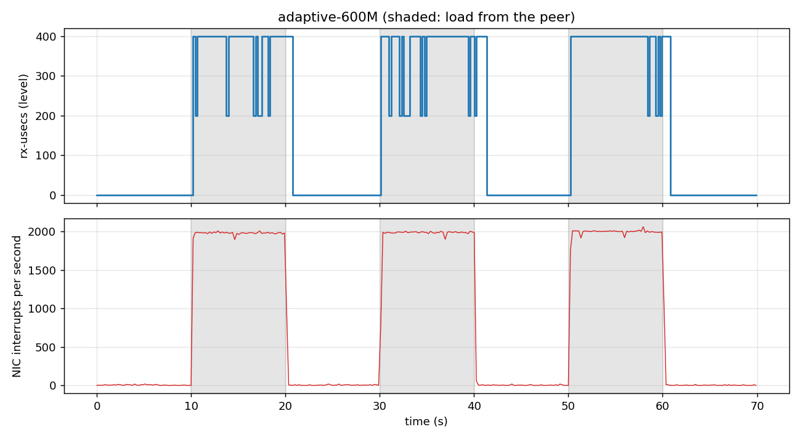
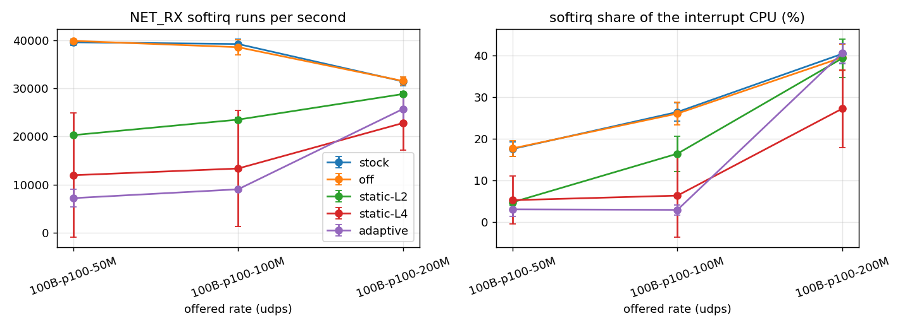
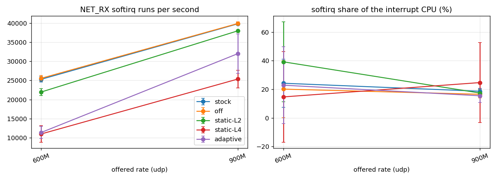
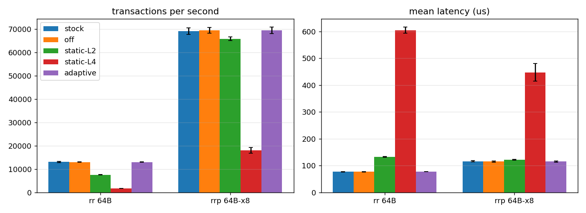
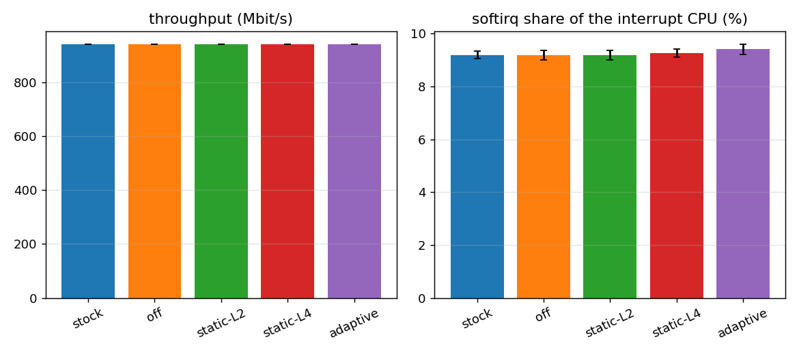

# The results explained

This document explains what the project measured, how, and what each result means. It starts with a short summary and a note on what the project is and how it was approached, then goes through every aspect of the results in detail. Every number comes from the phase results files in [`results/`](results/) and the raw logs in the top-level `results/` folder; the file that holds the original table is named next to each result.

Related documents: [project explained](project-explained.md) (the design and the code), [report](report.md) (the course report), [diagrams](diagrams/README.md), [setup and testing](setup-and-testing.md) (how to reproduce), [demo and questions](demo-and-questions.md).

## 1. What the project is and how it was approached

### 1.1 The project

A network card can hold back its receive interrupt for a short time, so that one interrupt covers several packets. The `r8169` driver (Realtek RTL8111/8168 Gigabit Ethernet, the card in the author's PC) could only be given a fixed hold time by hand with `ethtool -C`, and it started with no hold at all. A fixed hold time is a poor fit for traffic that changes: it saves CPU work when packets arrive fast and adds delay to every reply when they arrive one at a time.

The project adds an **adaptive receive interrupt moderation** mode. With `ethtool -C <dev> adaptive-rx on` the driver watches the traffic, lets the kernel's DIM library judge it, and moves the card's receive timer between five levels: 0, 40, 80, 200 and 400 microseconds. With `adaptive-rx off` the driver behaves like the stock one. The change is six patches against Linux 7.2.15 in two files; see [kernel changes](kernel-changes.md) and the [overview diagram](diagrams/00-overview.md).

### 1.2 The approach

| Step | Idea |
|---|---|
| Measure first | Phase 0 measured the stock driver, to learn where moderation could help at all. It showed that bulk TCP already takes about 2 interrupts per second and that request-response takes 2 interrupts per transaction, so the possible gain is in the middle range of heavy small-packet load |
| Use the kernel's own mechanism | DIM is used by other drivers (`virtio_net` is the model). The project supplies a level table, a sampling hook and an apply function, not a new algorithm |
| Build in small steps | Six patches, each of which builds and loads. The first patches only log; the register is written only from patch 0004 on, so DIM's behaviour was visible before it had any effect |
| Test every phase against a criterion written down beforehand | Phase 2 required request-response to stay within 5% of no moderation. It failed at first (-5.8%), which led to patch 0005 |
| Measure fairly | The same kernel build, interleaved configurations in rounds with alternating order, 12 runs per cell in the final matrix, a noise rule, and the stock module measured at both ends of the session |
| Report what is found | Including the unreliable 900 Mbit/s ramp-up, the findings outside the driver, and the cells that were not usable |

The phases are drawn in [diagram 9](diagrams/09-phases.md).

## 2. Results in brief

Measured on an RTL8168h at 1 Gbit/s with one peer, 12 runs per cell in the final matrix (mean values; "adaptive" against "off", the patched driver with the mode off, which matches the stock driver in every cell):

| Question | Answer | Where in this document |
|---|---|---|
| Does it reduce interrupt work under heavy small-packet load? | Yes. NET_RX softirq runs per second fall by 77 to 82% (100 byte UDP, 50 and 100 Mbit/s) and the NIC takes about 3,200 interrupts per second instead of about 17,000 to 20,000 | 5.3 |
| Does it reduce CPU time? | Yes. The interrupt CPU's non-idle time falls by 15% to 31% in those cells and by 22% at 600 Mbit/s of large UDP | 5.3, 5.4 |
| Does it cost throughput or add loss? | No | 5.3, 5.4, 5.6 |
| Does it slow request-response traffic? | No measurable cost. A fixed 80 us timer costs 42% of the transactions per second and a fixed 400 us timer costs 87% | 5.5 |
| Does it change bulk TCP? | No. 941 Mbit/s in every configuration, and about 2 interrupts per second with or without moderation | 5.6 |
| Does it follow a changing load quickly? | The level rises within 0.08 to 0.20 s of a burst starting and is back at 0 within about 0.4 s of the last packet | 5.7 |
| Is it robust? | It passed restart, forced reset, link-speed change, suspend and resume, a 36 minute stress run and concurrent ethtool calls, with lockdep enabled and no report | 5.8 |
| Where does it not work well? | At 900 Mbit/s of large UDP the level ramps up unreliably, so the gain there is partial (NET_RX -20%, CPU -18% on average) | 5.4, 5.7 |
| Is the final build the one that was measured? | Yes. A matched re-run on the frozen module agrees with the final matrix in every cell | 5.10 |

## 3. How to read the numbers

### 3.1 The measures

| Measure | Where it comes from | What it tells |
|---|---|---|
| Interrupts per second (irq/s) | `/proc/interrupts`, the row of the NIC | How often the card interrupts the CPU. This is what moderation changes directly |
| NET_RX per second | `/proc/softirqs`, summed over CPUs | How often the network receive softirq (NAPI poll) runs. Each run is CPU work |
| Interrupt CPU non-idle (%) | cpuidle residency of the CPU that takes the NIC interrupt: share of the wall time not spent in a cpuidle state | The CPU cost. It does not depend on the scheduler tick (see 3.3) |
| Throughput, loss, jitter | `iperf3` | Whether the traffic is delivered and how evenly |
| Transactions per second, mean latency | `netperf` TCP_RR | Latency traffic: one small request and one small reply at a time |

### 3.2 The configurations and workloads

Configurations: `stock` (the unmodified module), `off` (the patched module, mode off), `static-L2` (a fixed 80 us timer), `static-L4` (a fixed 400 us timer) and `adaptive`. Workloads: `rr` (one request-response stream), `rrp` (eight streams), `tcp` (bulk), `udp` (iperf3 UDP with 1448 byte datagrams at 600 and 900 Mbit/s) and `udps` (100 byte datagrams at 50, 100 and 200 Mbit/s, with a 100 microsecond pacing timer). [Diagram 7](diagrams/07-measurement-setup.md) shows the setup.

### 3.3 Two properties of the measurement that matter

1. **Pacing.** iperf3 paces its sending with a 1 ms timer by default, so packets arrive in bursts and the NIC takes about 2,000 interrupts per second at every offered rate from 25,000 to 250,000 packets per second, with or without moderation. The interrupt rate is then set by the sender and not by the packet rate. The `udps` workload therefore uses a 100 microsecond pacing timer, which makes the interrupt rate follow the load (calibration in `results/phase4/calibration/`). Cells with default pacing show their benefit as lower NET_RX and CPU use, not as a lower interrupt rate.
2. **Tick-sampled CPU figures.** The PC's kernel does not set `CONFIG_IRQ_TIME_ACCOUNTING`, so the busy and softirq percentages from `/proc/stat` are sampled at the scheduler tick. With paced traffic the same load read 0% in one run and 86% in the next. These percentages are not used for conclusions; the cpuidle-based figure is.

### 3.4 The noise rule

Results are reported as mean and standard deviation. A difference smaller than the larger of the two standard deviations is called noise. With 12 runs per cell an effect below about 1.5% cannot be resolved in the quietest cells. Phase 0 to 3 runs used the `powersave` governor; Phase 4 and 5 used `performance`, with the NIC interrupt pinned to one CPU and `irqbalance` stopped. Numbers are therefore compared only within a session, never across the two groups (the request-response rate is about 9,300 per second in Phase 2 and about 13,000 in Phase 4).

## 4. The baseline: what the stock driver does (Phase 0)

Source: [`results/phase_0_environment_and_baseline.md`](results/phase_0_environment_and_baseline.md); 5 runs of 20 s per cell.

| Finding | Numbers | Meaning for the project |
|---|---|---|
| The patched module with adaptive off matches the stock module | Within about 1.3% in every cell | The change is safe to leave switched off |
| Bulk TCP takes almost no interrupts | 941 Mbit/s with about 2 interrupts per second | NAPI already polls continuously at line rate: there is nothing for moderation to remove |
| Request-response takes 2 interrupts per transaction | 9,213 transactions/s and 108.4 us (stock) | Every reply is one interrupt, so any timer only adds latency |
| A static timer hurts request-response | 50 us: 6,632 transactions/s and 150.6 us (+42 us). 200 us: 3,390 and 295.3 us (+187 us) | The levels above 0 must be reached by load, never set statically |
| A static timer helps heavy UDP | 600 Mbit/s: NET_RX 20,315 (stock) to 16,792 (50 us, -17%) and 12,038 (200 us, -41%), no loss | There is a gain to find, and it is in softirq work |
| The all-CPU busy figure cannot separate configurations | Spread larger than the differences | A per-CPU measure was added, later the cpuidle measure |
| The interrupt counter is valid | 65.8 interrupts per second during a 51 Mbit/s download, after fixing which IRQ row to read (sysfs `device/irq` says 18, the MSI-X interrupt is 135) | The measure can be trusted |

## 5. The results, aspect by aspect

### 5.1 Does the code do what it should? (functional tests, Phases 1 to 2)

Sources: [`results/phase_1_plumbing.md`](results/phase_1_plumbing.md), [`results/phase_2_adaptive_core.md`](results/phase_2_adaptive_core.md).

| Test | What was checked | Result |
|---|---|---|
| F1, F3 (Phase 1) | The flag reads `off` after load, `on` after `adaptive-rx on`; with adaptive off `ethtool -c` matches the stock output apart from the flag line (stock prints `n/a`); a static `rx-usecs 50` round-trips | Pass |
| T1 | Registers with the mode on: `CPlusCmd 0x20e1` (`INTT` 1, `PktCntrDisable` 1) and `IntrMitigate 0x0000` at idle | Pass |
| T2 | Static `rx-usecs 50` is saved when adaptive is turned on and comes back when it is turned off | Pass |
| T3 | `adaptive-rx on tx-frames 8` is refused with a message and the state is unchanged | Pass |
| T4 | Under 600 Mbit/s UDP the timer field reaches 5 (200 us) and 10 (400 us); NET_RX falls from 20,872 to 3,792 per second | Pass |
| T5 | Request-response with the mode on stays within 5% of the mode off | **Failed** with patches 0003 and 0004 (-5.8%), **passed** with 0005 (+1.8%); see 5.9 |
| T6 | Bulk TCP unchanged | 941.2 against 941.3 Mbit/s |
| T8 | The patched module with adaptive off matches the earlier run | 9,340 against 9,330 transactions/s |
| T9, T10 | Warning-free build at `W=1`; five rounds of mode on, load, link down, `rmmod`, `insmod` | Pass; no hang |

### 5.2 Build quality (all phases, and Phase 5 on a clean tree)

| Check | Result |
|---|---|
| `make W=1` on the PC and on a clean `v7.2.15` tree with lockdep (`PROVE_LOCKING`) | 0 warnings from `r8169_main.c` |
| `checkpatch.pl --strict` on every patch | Only the `Co-authored-by` signature warning, the missing `Signed-off-by` on the unsigned files in `patches/`, and three CamelCase checks on register names the driver already uses |
| All six patches on a clean `v7.2.15` | Apply in order with `git am` and with `patch -p1`, with identical results (`scripts/check_series.sh`) |
| `sparse` | **Not run**: the PC had none and the one available while checking the clean tree was too old |

### 5.3 Heavy small-packet load (the case moderation is for)

Source: Phase 4 results, section 4.4 (12 runs per cell, `adaptive` against `off`). 100 byte datagrams with a 100 us pacing timer, so the interrupt rate follows the load. [Diagrams 1 to 3](diagrams/00-overview.md) show where each effect comes from.

| Offered | NET_RX/s, off to adaptive | Change | NIC interrupts/s, off to adaptive | Interrupt CPU non-idle, off to adaptive | Jitter |
|---|---|---|---|---|---|
| 50 Mbit/s (62,500 pkt/s) | 39,885 to 7,176 | -82.0% | 19,876 to 3,119 | 26.1% to 22.1% (-15.5%) | 0.007 to 0.017 ms (static 400 us: 0.021) |
| 100 Mbit/s (125,000 pkt/s) | 38,568 to 9,017 | -76.6% | 16,871 to 3,288 | 36.1% to 25.0% (-30.9%) | no change (0.005 to 0.006 ms) |
| 200 Mbit/s (250,000 pkt/s) | 31,537 to 25,716 | -18.5% | not used (see below) | 50.2% to 45.4% (-9.6%) | |

What this means:

- With adaptive mode the NIC takes about 3,100 to 3,300 interrupts per second at the top level. Dividing packets per second by interrupts per second gives about 20 packets per interrupt at 50 Mbit/s (62,500 / 3,119) and about 38 at 100 Mbit/s (125,000 / 3,288).
- The gain equals that of a **fixed** 400 us timer (CPU -15.5% against -12.7% at 50M, -30.9% against -28.8% at 100M), but it is obtained only while the load lasts.
- Throughput stays at the offered rate and the loss is zero, except for noise: at 200 Mbit/s the loss is 0.0146% against 0.0037%, within the spread (one run lost 0.126%).
- The price is **packet delay**: jitter at 50 Mbit/s rises from 0.007 to 0.017 ms. At 100 Mbit/s there is no change.
- The 200 Mbit/s cell is close to what the sender can produce (about 260,000 packets per second), so the receive path is nearly always in polling mode and the cell was not used for decisions.

The softirq share drawn in the figure is the tick-sampled counter that section 3.3 says not to rely on; the cpuidle-based figures are in the table above.

### 5.4 Heavy load with large packets

| Offered | NET_RX/s, off to adaptive | Change | Interrupt CPU non-idle | Notes |
|---|---|---|---|---|
| UDP 600 Mbit/s, 1448 byte datagrams | 25,569 to 11,375 | -55.5% | 25.9% to 20.3% (-21.7%) | Level reaches the top; static 400 us: NET_RX -57% |
| UDP 900 Mbit/s | 39,926 to 32,025 | -19.8% | 30.8% to 25.2% (-18.2%) | Partial: see 5.7 |

With iperf3's default pacing the NIC takes about 2,000 interrupts per second in these cells whatever the configuration, so the gain shows only in NET_RX and CPU use. At 900 Mbit/s the result varies strongly between runs (standard deviation 5,208 on a mean of 32,025), because the level does not always climb. Throughput and loss are unchanged (loss 0.0000% against 0.0017% is noise).

### 5.5 Latency traffic: it must cost nothing

Source: Phase 4 results, section 4.4. One `netperf` TCP_RR stream (`rr`) and eight streams (`rrp`), 64 byte messages.

| Cell | stock | off | static 80 us | static 400 us | adaptive |
|---|---|---|---|---|---|
| `rr` transactions/s | 13,018 | 12,973 | 7,553 | 1,655 | 12,962 |
| `rr` mean latency (us) | 76.8 | 77.1 | 132.4 | 604.4 | 77.1 |
| `rrp` transactions/s | 69,057 | 69,436 | 65,793 | 17,963 | 69,394 |
| `rrp` mean latency (us) | 115.9 | 115.2 | 121.6 | 447.2 | 115.3 |

- `adaptive` against `off`: transactions per second -0.1% and latency +0.1% in both, which is noise.
- A static timer is not usable for this traffic: 80 us costs 42% of the `rr` transactions per second, and 400 us costs 87% (and 74% for `rrp`).
- The result depends on patch 0005. Without the single-packet guard the same traffic lost 5.8% (8,794 against 9,340 transactions per second in the Phase 2 session), because DIM left level 0 on statistics noise and every visit to level 1 added the full 40 us to each reply. See 5.9.
- The level traces of `rrp` (3 runs, 637 samples) show 93% of the samples at 0 us, 5% at 40 us and 2% at 80 us, none higher. The mean timer is about 3.6 us, which matches the 4 us rise of the mean latency in an earlier exploratory run (113.1 to 117.2 us). That small cost is DIM exploring levels 1 and 2. It did not reproduce in the final matrix (-0.1%) and cannot be resolved with 12 runs.

### 5.6 Bulk TCP

| Measure | Result |
|---|---|
| Throughput | 941.2 Mbit/s in every configuration |
| NIC interrupts per second | about 2 (stock 1.8, adaptive 1.9 in Phase 2) |
| NET_RX per second | -0.4% (noise) |
| Interrupt CPU non-idle | 14.4% (off) against 14.8% (adaptive), +2.7%, noise |

At line rate with a fast CPU the NAPI poll rarely completes, so the interrupt is almost always masked and moderation has nothing to remove. The result is "unchanged", not "improved". One small possible cost is recorded: the tick-sampled softirq share rises by about 0.2 points (9.4 against 9.2), which the cpuidle-based figure cannot resolve.

### 5.7 How the level behaves over time

| Behaviour | Result | Source |
|---|---|---|
| Rise at the start of a burst (600 Mbit/s UDP, 3 cycles) | Above 0 within 0.08 to 0.20 s, and at 400 us within the same 0.2 s sampling interval | Phase 4, 4.5 |
| Fall after a burst | Back at 0 after 0.77, 1.31 and 0.76 s from the end of the burst as marked by iperf3, which includes a few hundred milliseconds of slack. Measured directly: 0.39 s from the last packet seen at a level above 0 to level 0 | Phase 4, 4.5; Phase 3, F9 |
| Time at each level | 54% of the samples at 0 us, 6% at 200 us, 41% at 400 us; 0.5 level changes per second. The control run with the mode off stays at 0 us in all 317 samples | Phase 4, 4.5 |
| Small-packet load, 10 runs at 50 Mbit/s | Nine runs reach about 390 us within the first second and stay there (1.1% of the samples below 200 us). Run 1 ramped late (mean 261 us). In the demo the level dips to 200 us for a few samples in 30 and goes back up | Phase 4, 4.3 |
| 900 Mbit/s of large UDP, 10 runs | Bimodal: one run reached the top level (mean 364 us), three stayed at level 0 for the whole run (mean 14 to 60 us, NET_RX as with the mode off), six sat in between (91 to 158 us) | Phase 4, 4.3 |

Why 900 Mbit/s is unreliable: DIM judges packets, bytes and polls per millisecond. At that rate those counters change little between levels, so DIM does not see a benefit in moving up. A fixed 400 us timer cuts NET_RX by 36% there but does not cut the interrupt rate, which supports this explanation. It is a limit of what DIM counts and not of the table; this was not tested further, and no change to the algorithm was made.

The idle fall needed code: before patch 0006 the level stayed at 400 us after the load stopped (test T7), which would delay the first packets of the next sparse traffic.

### 5.8 Robustness (Phase 3)

Source: [`results/phase_3_robustness.md`](results/phase_3_robustness.md); lockdep enabled, the kernel log checked after each test. Mechanisms: [diagram 5](diagrams/05-lifecycle.md) and [diagram 6](diagrams/06-locking.md).

| Test | Situation | Result |
|---|---|---|
| F4 | 10 rounds of interface down and up | After every up: `CPlusCmd 0x20e1`, `IntrMitigate 0x0000` (level 0) |
| F4b | A forced reset of the chip under 600 Mbit/s load, with a debugfs test hook | The log shows `TEST restore: level 4, IntrMitigate 0x00a0` right after the reset: the level was written again. See "findings outside the driver" below for the RX stall that follows with or without the patches |
| F5 | Link speed 1000, 100, 1000 Mbit/s under load | At 100 Mbit/s the level rose to `rx-usecs: 82` (`IntrMitigate 0x0040`, 4 units of 20.48 us): level 2 converted correctly. Back at 1 Gbit/s the original values returned |
| F6 | Suspend to memory with `rtcwake` | Mode still on, `IntrMitigate 0x0000` right after resume, levels rose again under load |
| F7 | 36 minutes: 19 link bounces and 20 module reloads under 300 Mbit/s UDP and request-response, the mode toggled every 100 ms | No oops, `WARN` or lockdep report. All 9 bounces with the toggling paused found the level above 0, so teardown ran with the decay work armed |
| F9 | Idle decay | 0.39 s from the last packet to level 0 |
| F10 | Request-response right after a burst | 9,646, 9,435, 9,297 transactions/s (mode on) against 9,599 and 9,100 (mode off): no regression |
| F11 | 60 s of concurrent `adaptive-rx` and `tx-usecs` changes | No hang; TX settings kept (`tx-usecs 20` reads back as 40 because one unit is 40 us at 1 Gbit/s, which is the stock rounding) |

Findings outside the driver, recorded and not fixed:

- **This network forwards nothing for about 35 s after every link-up** (a switch effect: 3 to 4 unanswered ARP requests per second, then traffic returns at 35.4 s, identically in two runs and with the stock module). After any link change, wait about 40 s before measuring or demonstrating.
- **A forced reset under 600 Mbit/s receive load leaves RX dead for 20 s or more** with the mode on or off, so it is not caused by the patches. It may be the same switch effect (not proven).

### 5.9 Problems found on the way, and what was done

| Problem | Evidence | Action |
|---|---|---|
| Request-response lost 5.8% with patches 0003 and 0004 | T5: 8,794 against 9,340 transactions per second; mean latency 113.6 against 107.0 us | Patch 0005, the single-packet guard. A smaller first step and a lower top level would have given up much of the UDP gain, and accepting the loss was against the plan's own criterion |
| 900 Mbit/s UDP bimodal | Two of five runs behaved like the mode off | Diagnosed with level traces in Phase 2; carried to Phase 4, reported as a limitation |
| The level stayed high after a burst | T7 | Idle decay in patch 0006 |
| Interrupt counts wrong at first | Read the wrong IRQ row | Script fixed to match `/proc/interrupts` by device name |
| A disturbed visit in the final matrix | A transmit watchdog timeout and chip reset in one `static-L4` visit: the failed run and two runs without a timer were removed from `static-L4/summary.csv` (raw logs kept, listed in `warnings.txt`), leaving 10, 10 and 9 runs in three cells | Not investigated further; a reset drops a static timer (stock behaviour), the adaptive level is restored |
| First Phase 5 check used the wrong pacing | `udps` interrupt rate about 2,000 per second | Re-run with the Phase 4 pacing, see 5.10 |

### 5.10 Is the final build the measured build? (Phase 5)

Source: [`results/phase_5_report_and_demo.md`](results/phase_5_report_and_demo.md). Module srcversion `04E8D19E5DCBE28E8305847` on kernel `7.2.15-netquota`, both configurations in one session, governor `performance`, 3 runs per cell.

| Cell | off | adaptive | Change | Phase 4 final |
|---|---|---|---|---|
| `rr` transactions/s | 13,096 | 13,101 | noise | 12,973 and 12,962 |
| `udps` 50M NET_RX/s | 39,695 | 6,532 | -83.5% | -82.0% |
| `udps` 100M NET_RX/s | 39,023 | 9,426 | -75.8% | -76.6% |
| `udps` interrupts/s, 50M and 100M | 19,675 and 16,905 | 2,810 and 3,240 | -86% and -81% | 19,876 to 3,119 and 16,871 to 3,288 |
| Interrupt CPU non-idle, 50M and 100M | 24.7% and 36.0% | 22.0% and 25.4% | -10.9% and -29.4% | -15.5% and -30.9% |

The re-run agrees with the final matrix in every cell, inside the spread of three runs. The `rr` interrupt-CPU figure (18.4 against 16.7) is marked better by the summary script but equals the spread of the adaptive runs and is not claimed. Three of the nine `rr` runs of the session had one transaction of about 200 ms (the size of the TCP minimum retransmission timeout); the same occurs with `stock` and `off` in the Phase 4 matrix (10, 14 and 16 of 48 runs for stock, off and adaptive), so adaptive mode does not cause it.

### 5.11 The demo as a result

Three rehearsals and a recorded run (`results/phase5/`) show the same behaviour as the tables: the level reaches 400 us during a 100 byte UDP burst with about 3,160 to 3,490 interrupts per second, dips to 200 us in a few samples, falls to 0 when the burst ends, and request-response runs at about 12,900 to 13,100 transactions per second at level 0 against 1,550 to 1,660 with a fixed 400 us timer. The rehearsals also found that the fall of the level could not be seen in stage 4 of the demo script; the script was changed (no pause between stages 3 and 4, sampling every 0.2 s). See [demo and questions](demo-and-questions.md).

## 6. Limitations: how far the results reach

- One chip variant (RTL8168h), one peer, one link speed (1 Gbit/s). The numbers are not generalised.
- Twelve runs per cell (three in the Phase 5 re-run) resolve differences of about 1.5% or more in the quietest cells.
- The CPU measure is the idle residency of the interrupt CPU and counts the polling idle state as idle.
- iperf3 UDP is paced, and the sender cannot exceed about 260,000 packets per second of 100 byte datagrams.
- Phase 4 and 5 conditions (governor `performance`, interrupt pinned to one CPU) differ from Phases 0 to 3.
- The 900 Mbit/s ramp-up is reported, not fixed.
- The single-packet guard is a heuristic on top of the stock DIM algorithm.
- `sparse` was not run; no other chips were tested; the series has not been reviewed by a maintainer.

## 7. Where each result comes from in the code

| Result | Mechanism | Diagram |
|---|---|---|
| Fewer interrupts and less softirq work under heavy small-packet load | The receive timer holds interrupts back; DIM raises the level when packets per millisecond are high | [3](diagrams/03-apply-level.md), [2](diagrams/02-dim-decision.md) |
| No cost for request-response | Level 0 has no timer; the single-packet guard keeps DIM at level 0 for single-packet polls | [1](diagrams/01-poll-and-sampling.md) |
| Quick rise, fall after traffic stops | DIM is sampled on every poll; the delayed decay work resets the level after 200 ms without polls | [1](diagrams/01-poll-and-sampling.md), [5](diagrams/05-lifecycle.md) |
| The mode off behaves like stock | `rtl_write_coalesce()` with `adaptive` false is the stock path | [4](diagrams/04-ethtool-control.md) |
| Survives restarts, link changes, teardown | Restore, link work and ordered cancels under one mutex | [5](diagrams/05-lifecycle.md), [6](diagrams/06-locking.md) |
